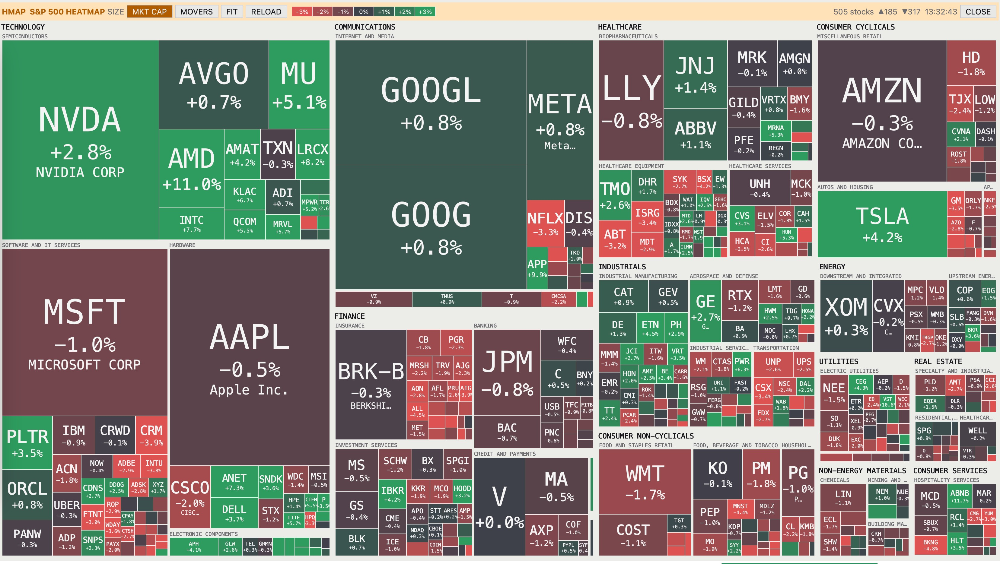

# Market Terminal

C++/Qt5/Go port of https://github.com/melpomenex/terminal

# NEW FEATURES

* Light mode
* Heatmap

<p align="center">
  
</p>

* Batching: Yahoo API batches requests, so you are less likely to get blocked
* Pacing: Yahoo and SEC Edgar are ratelimited, so you don't get blocked

## Building

Requires go-1.21 and qt5

```bash
./build.sh
```

### Windows

```bash
./build.bat
```

## Configuration

SEC EDGAR requires a contact e-mail in the User-Agent. Put it into
`.settings.yaml` in the config dir:

```yaml
email: you@example.com
```

(or set `QUBE_SEC_UA="Your Name you@example.com"`).

| | Linux | macOS | Windows |
|---|---|---|---|
| config: `.settings.yaml` (backend), `settings.json` (terminal) | `~/.config/market-terminal` | `~/Library/Preferences/market-terminal` | `%APPDATA%\market-terminal` |
| cache: EDGAR, Yahoo, S&P 500 downloads | `~/.cache/market-terminal` | `~/Library/Caches/market-terminal` | `%LOCALAPPDATA%\market-terminal\Cache` |
| state: rate-limit lock files | `~/.local/state/market-terminal` | `~/Library/Application Support/market-terminal` | `%LOCALAPPDATA%\market-terminal` |

`XDG_CONFIG_HOME`, `XDG_CACHE_HOME` and `XDG_STATE_HOME` are used when set
(also on macOS).

The backend listens on `127.0.0.1:4032` (`-listen` or `QUBE_LISTEN` to
change). The terminal connects to `http://localhost:4032` (pass another URL as
first argument or set `QUBE_TERMINAL_URL`).

## Running

```bash
./build/bin/market-terminal-backend
````

```bash
./build/bin/qt-market-terminal
```

